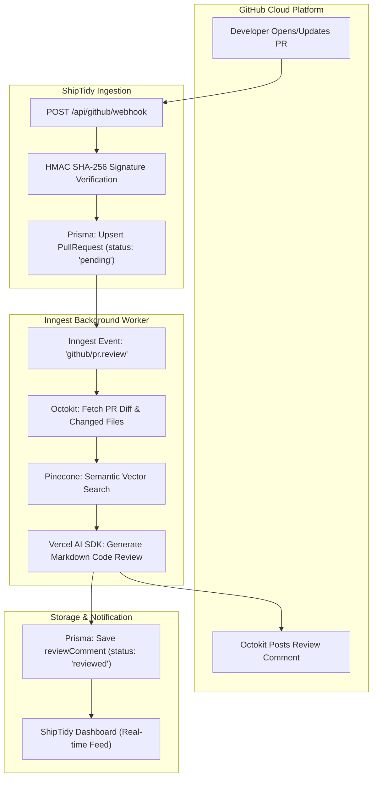
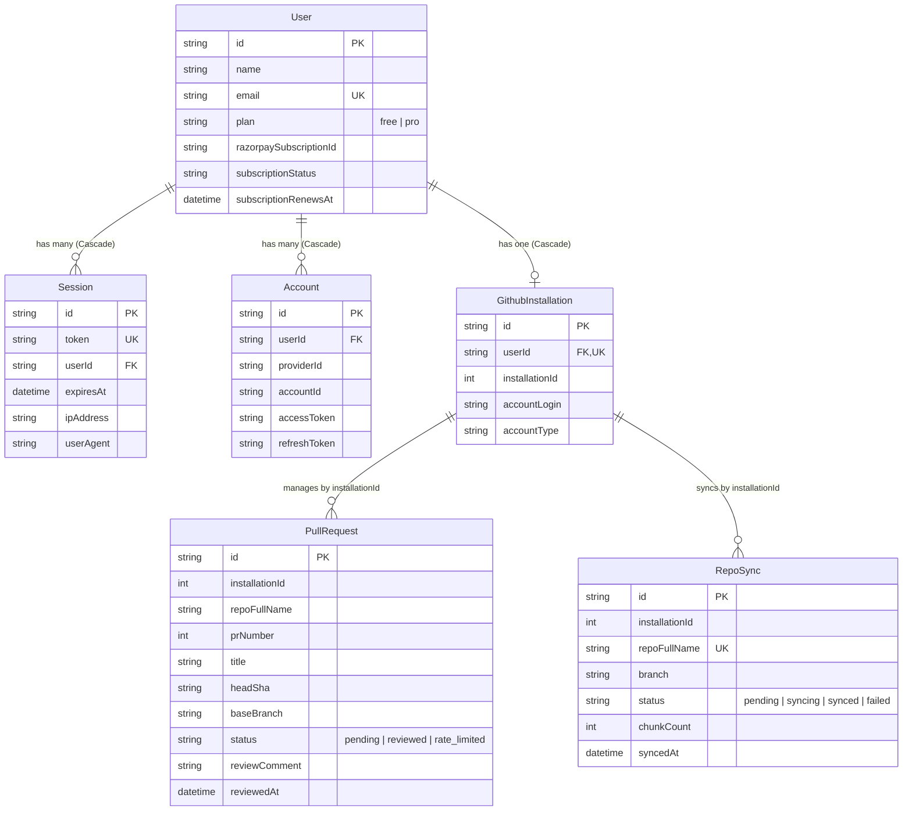

# ShipTidy
### Automated, Context-Aware GitHub Pull Request Code Review System

**Lead Presenter:** Divyansh & Engineering Team  
**Domain:** Cloud Architecture, Distributed Systems & AI Engineering  
**Stack:** Next.js 16 (App Router), React 19, Prisma 7, PostgreSQL, Inngest, Pinecone DB, Razorpay  

---

## Slide 2: Project Architecture & Execution Flowchart



- **Resilience:** Background jobs in Inngest prevent serverless HTTP timeout penalties.
- **RAG Context:** Pinecone vector search injects existing code patterns into review prompts.

---

## Slide 3: Entity Relationship (ER) Diagram & Relations



---

## Slide 4: Database Schema Mappings & Core Production Queries

### 1. Database Schema Breakdown (7 Tables)
| Table | Model | Primary Key | Key Indexes & Constraints | Functional Role |
| :--- | :--- | :--- | :--- | :--- |
| `user` | `User` | `id` (String) | `@@unique([email])` | User identity & Razorpay subscription tier |
| `session` | `Session` | `id` (String) | `@@unique([token])`, `@@index([userId])` | Active sessions with cascade delete |
| `account` | `Account` | `id` (String) | `@@index([userId])` | OAuth tokens (GitHub Provider) |
| `github_installation`| `GithubInstallation` | `id` (cuid) | `@@unique([userId])` | GitHub App tenant installation ID |
| `pull_request` | `PullRequest` | `id` (cuid) | `@@unique([repoFullName, prNumber])` | PR reviews, status, and AI markdown |
| `repo_sync` | `RepoSync` | `id` (cuid) | `@@unique([repoFullName])` | Pinecone vector embedding synchronization |
| `verification` | `Verification`| `id` (String) | `@@index([identifier])` | Token verification records |

---

### Slide 4 (Continued): Core Production Queries

#### Query 1: Atomic Webhook PR Upsert
```typescript
await prisma.pullRequest.upsert({
  where: { repoFullName_prNumber: { repoFullName, prNumber } },
  create: {
    installationId, repoFullName, prNumber,
    title, headSha, baseBranch, status: "pending"
  },
  update: { title, headSha, status: "pending" }
});
```

#### Query 2: Review Usage Meter (Monthly Free Tier Limit)
```typescript
const reviewsUsed = await prisma.pullRequest.count({
  where: {
    installationId,
    status: "reviewed",
    reviewedAt: { gte: startOfMonth }
  }
});
```

#### Query 3: Dashboard Chronological Activity Feed
```typescript
await prisma.pullRequest.findMany({
  where: { installationId, status: { in: ["reviewed", "rate_limited"] } },
  orderBy: { updatedAt: "desc" },
  take: 10,
  select: { id: true, repoFullName: true, prNumber: true, status: true, reviewedAt: true }
});
```

---

## Slide 5: Frontend Views & Architecture Walkthrough

1. **Landing & Marketing View (`app/page.tsx`)**:
   - Hero section with live interactive code diff animation.
   - Core value proposition, feature grid, and transparent Razorpay pricing tiers.

2. **Authentication Flow (`app/(auth)/sign-in`)**:
   - One-click GitHub OAuth via Better Auth with automated GitHub App installation prompt.

3. **Dashboard Overview Hub (`app/(protected)/dashboard/overview`)**:
   - Real-time GitHub App connectivity badge.
   - Monthly review usage progress meter (`used / limit`).
   - Repository health metrics and live review audit feed.

4. **Repository Manager & Vector Sync (`app/(protected)/dashboard/repos`)**:
   - Lists connected GitHub repositories.
   - One-click codebase embedding trigger into Pinecone vector index.

5. **Pull Request Review Inspector (`app/(protected)/dashboard/pull-request/[id]`)**:
   - Detailed Markdown rendering with syntax highlighting and suggested code changes.

6. **Settings & Billing (`app/(protected)/dashboard/settings`)**:
   - Self-service plan upgrading via Razorpay checkout with instant webhook synchronization.

---

## Slide 6: Engineering Highlights & System Impact

- **Decoupled Architecture**: Webhook ingestion returns `200 OK` in <50ms; heavy AI diff synthesis is delegated to Inngest background workers.
- **Precision RAG**: Pinecone vector embeddings ground LLM reviews in real codebase context, dramatically cutting false positive comments.
- **Enterprise Security**: Webhook SHA-256 HMAC verification, scoped queries by `installationId`, and encrypted token persistence.
- **Multi-Tenant Ready**: Scalable across thousands of repositories with independent usage tracking and automated Razorpay subscription management.
